<p align="center">
  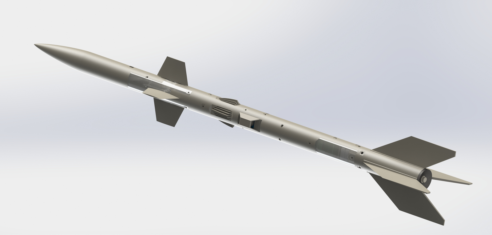
</p>

<h1 align="center">DustArrow X · 沙尘利«箭»</h1>

<p align="center">
  <strong>Système de télémétrie modulaire pour fusée-sonde météorologique de 40 mm</strong>
  <br>
  Chaîne de capteurs RP2040, liaison descendante LoRa et station au sol PyQt5
</p>

<p align="center">
  <a href="./LICENSE"></a>
  
  
  
  
  <br>
  <a href="./README.md">English</a> |
  <a href="./README.zh-CN.md">中文</a> |
  <a href="./README.fr.md">Français</a>
</p>

---

## Origine du nom

Le nom chinois « 沙尘利箭 » associe « 沙尘 » (poussière de sable) et « 利箭 »
(flèche acérée). Il désigne la fusée-sonde et un instrument utile contre les
tempêtes de poussière. Le nom anglais **DustArrow** en est la traduction directe.
La structure modulaire s’inspire des armoires expérimentales de la station
spatiale chinoise. La troisième génération ajoute **X** ; l’auteur explique que X
signifie « des possibilités infinies ».

## À propos du projet

DustArrow X est la troisième génération documentée d’un projet étudiant du lycée
n° 1 de Guyuan, au Ningxia, après Theta et Beta. Il a été présenté au Concours
national chinois d’innovation scientifique et technologique pour la jeunesse et
dans *Young Edison* saison 8 sur la télévision de Shanghai en janvier 2024. Le
projet mesure la structure verticale de l’atmosphère pendant les épisodes de
poussière avec une fusée-sonde à faible coût.

La cellule mesure 40 mm de diamètre et comporte dix sections fonctionnelles. Les
modules sont reliés par des contacts à doigts dorés, avec un circuit imprimé
flexible dans chaque baie. L’électronique de bord s’articule autour d’un RP2040,
d’un MPU6050, d’un BMP280, d’un ATGM336H, d’un modem LoRa A39C, d’un capteur de
poussière GP2Y1014AU0F et de capteurs de gaz MQ. Le segment sol est une
application Python/PyQt5.

Cette archive couvre la conception mécanique, les données de fabrication
électronique, le code de la station au sol, le rapport original, la présentation
et les médias. Le code du firmware de vol et les journaux de vol sont hors du
périmètre de cette archive ; voir [firmware/README.md](firmware/README.md).

## Caractéristiques principales

- **Cellule modulaire de 40 mm** : dix sections, contacts à doigts dorés et FPC,
  pièces imprimées remplaçables individuellement.
- **Chaîne de capteurs RP2040** : IMU six axes, baromètre, GNSS, poussière et gaz.
- **Liaison descendante LoRa** : modem série A39C-T400A22D1a reçu à 9600 bauds.
- **Station au sol PyQt5** : six courbes, vue d’attitude 3D et acquisition série.
- **Fichiers de fabrication ouverts** : sources SolidWorks, STL, STEP, Gerber,
  nomenclature et sérigraphies.
- **Suite de vérification** : 32 tests Python et 16 errata documentés couvrant les
  mathématiques d’attitude, la trame et la géométrie.

## Architecture du système

<p align="center">
  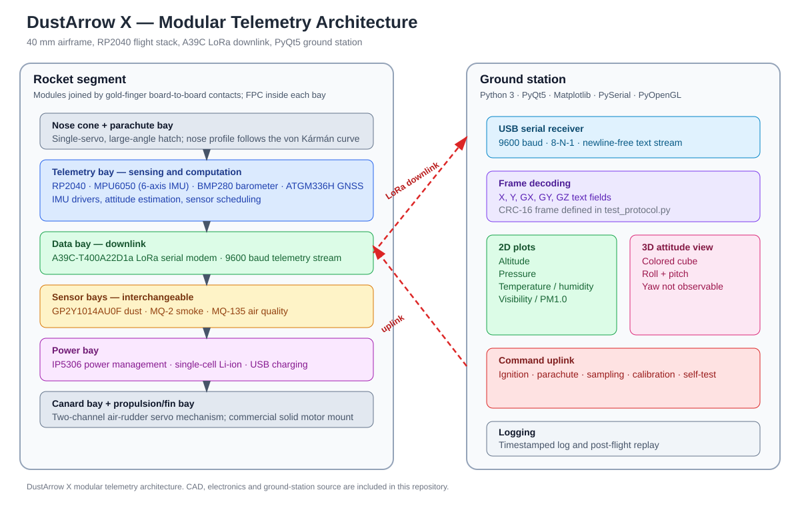
  <br>
  <em>Architecture du système. Les traits pointillés représentent la liaison radio ; la voie de commande est indiquée à titre de référence.</em>
</p>

- **Mécanique** : ogive et baie de parachute, baies de télémétrie, de données,
  d’alimentation, trois baies de capteurs, baie de commande principale, baie
  canard et baie de propulsion/empennage. Le parachute utilise un servo à grande
  ouverture ; les canards forment un mécanisme à deux canaux.
- **Électronique** : neuf nomenclatures et dix archives Gerber. Les cartes
  principales s’articulent autour du RP2040, du MPU6050, du BMP280, de
  l’ATGM336H et de l’A39C.
- **Liaison descendante** : flux texte à 9600 bauds, 8-N-1. Une trame binaire avec
  CRC-16 est définie et testée dans `scripts/verify_theory/test_protocol.py`.
- **Station au sol** : PyQt5, Matplotlib et OpenGL ; acquisition série, analyse de
  texte, six courbes et vue d’attitude.

## Théorie et conception

Au repos, l’accéléromètre mesure la réaction à la gravité. Avec \(x\) vers
l’avant, \(y\) vers la droite et \(z\) vers le haut :

\[
\phi = \operatorname{atan2}(a_y, a_z),
\qquad
\theta = \operatorname{atan2}\!\left(-a_x,\sqrt{a_y^2+a_z^2}\right).
\]

L’implémentation utilise `atan2` pour conserver le quadrant. Le filtre
complémentaire du premier ordre utilise une période d’échantillonnage explicite :

\[
\alpha = \frac{\tau}{\tau+\Delta t},
\qquad
\theta_k = \alpha\,\theta_{\mathrm{acc},k}
+ (1-\alpha)\left(\theta_{k-1} + \omega_y \Delta t\right).
\]

La démonstration complète, les conventions de repère et les corrections se
trouvent dans [Principe de fonctionnement](docs/fr/theory_of_operation.md) et les
[errata](docs/errata.md).

## Structure du dépôt

```text
DustArrow/
├── BOM/                     # consolidated bill of materials
├── electronics/
│   ├── datasheets/          # manufacturer datasheets
│   ├── output/              # Gerber, BOM, silkscreen, PCB 3D
│   └── source/              # legacy EasyEDA project
├── mechanical/
│   ├── output/              # STL, STEP, reprint files
│   └── source/              # SolidWorks drafts, formal parts, reprints
├── simulation/cfd/          # CFD project and animations
├── software/ground_station/ # PyQt5 ground-station source
├── firmware/                # interface and protocol notes
├── docs/                    # trilingual docs, errata, verification, archive
├── media/                   # photos, GIFs, videos
├── scripts/verify_theory/   # reproducible tests
└── .github/                 # issue and PR templates
```

Les sources mécaniques conservent leurs noms chinois, car les assemblages
SolidWorks les référencent. Les sorties STL utilisent des noms anglais et
incluent `part_name_mapping.csv`. La correspondance complète figure dans
[MIGRATION_NOTES.md](MIGRATION_NOTES.md).

## Nomenclature

| Indicateur | Valeur |
|---|---:|
| Modules PCB | 9 |
| Lignes de nomenclature | 48 |
| Pièces | 57 |
| Sous-total chiffré | 31,44 CNY |
| Lignes sans prix | 16 |

Les prix proviennent des exports de modules du 2023-08-15. Le détail complet est
dans [BOM/bill_of_materials.csv](BOM/bill_of_materials.csv) ; le résumé par
module est dans [BOM/bom_summary.csv](BOM/bom_summary.csv).

## Démarrage

**Station au sol** (Python 3.11) :

```bash
cd software/ground_station
python -m pip install -r requirements.txt
python appMain.py
```

L’application énumère les ports série, ouvre le port en 9600 8-N-1, analyse les
champs `X`, `Y`, `GX`, `GY`, `GZ` et écrit `data.txt`. Le chemin de données
implémenté est décrit dans
[software/ground_station/README.md](software/ground_station/README.md).

**Mécanique et électronique** : ouvrir les assemblages dans
[mechanical/source/formal/](mechanical/source/formal/) ou utiliser directement les
STL de [mechanical/output/3dp/](mechanical/output/3dp/). Les fichiers de
fabrication PCB sont dans [electronics/output/gerber/](electronics/output/gerber/).
La procédure est décrite dans le [guide de reproduction](docs/fr/replication_guide.md).

**Vérification** :

```bash
python scripts/verify_theory/run_verification.py
```

## Démonstration et tests

<p align="center">
  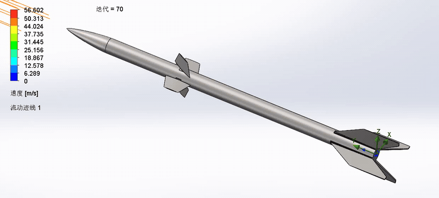
  <br>
  <em>Démonstration CFD. Les vidéos originales sont dans media/videos/.</em>
</p>

<p align="center">
  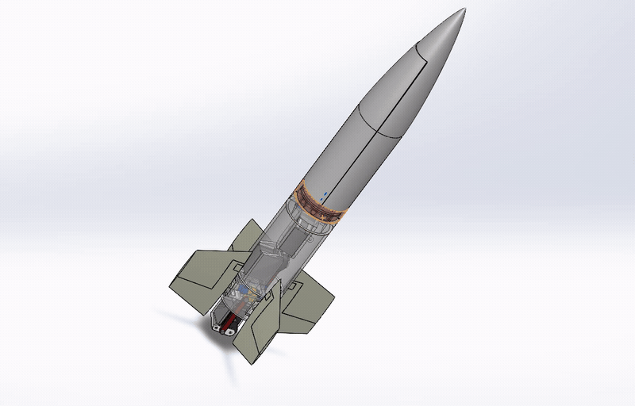
  <br>
  <em>Animation du mécanisme : séparation de l’ogive, déploiement des canards et récupération.</em>
</p>

<p align="center">
  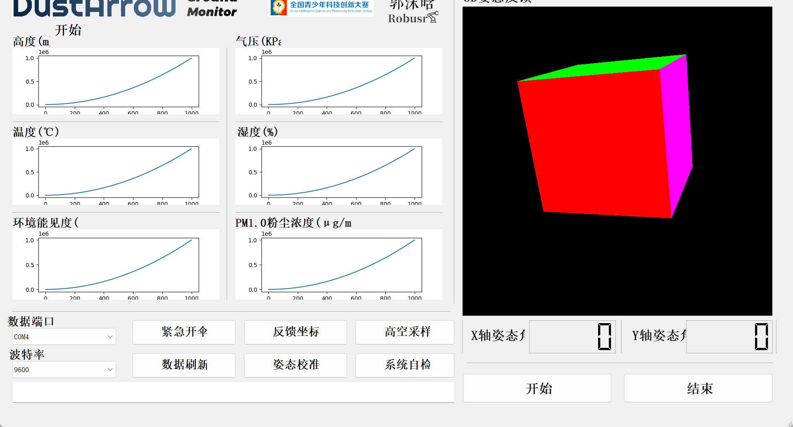
  <br>
  <em>Disposition de l’interface de la station au sol.</em>
</p>

Résultat de vérification : 32 tests réussis. La suite couvre les formules
d’attitude, le filtre complémentaire, les quaternions, l’analyse de trame, la
courbe de von Kármán, la géométrie STL, le contour Gerber et le coût de la
nomenclature. Voir [Vérification](docs/verification.md).

## Couverture médiatique

En janvier 2024, l’émission de science pour la jeunesse *Young Edison* saison 8,
*Tomorrow’s World*, diffusée par la télévision de Shanghai, a consacré un sujet au
projet. L’épisode documente un essai en vol près de Guyuan à la fin de l’automne
ou au début de l’hiver 2023. L’allumage à distance a été remplacé par un allumage
filaire, et la fusée a quitté le rail. La section des capteurs a été récupérée ;
la baie de parachute et le module de propulsion ont été perdus. L’élève estime le
taux de récupération à 80 %. L’épisode explique aussi que X signifie « des
possibilités infinies » et montre la station au sol lisant un fichier texte pour
le retour d’attitude. Cinq images fixes et deux courts extraits de l’émission
sont inclus ci-dessous.

- [Couverture détaillée](docs/fr/media_coverage.md)
- Pages officielles : [aperçu](https://www.kankanews.com/detail/ELwxNKJWGy9),
  [épisode](https://www.kankanews.com/detail/LMwVGm9WB2z),
  [présentation de la saison](https://www.kankanews.com/detail/boy4AKjBxQ1)

### Images de l’émission

<p align="center">
  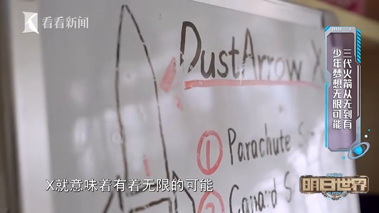
  <br>
  <em>Tableau DustArrow X et cellule imprimée.</em>
</p>

<p align="center">
  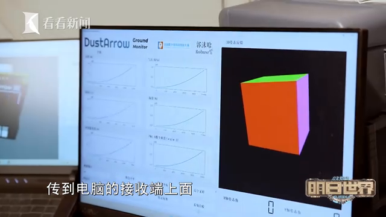
  <br>
  <em>Interface de la station au sol dans l’émission.</em>
</p>

<p align="center">
  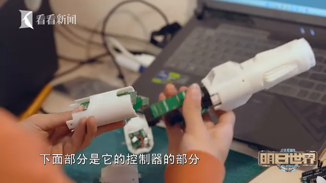
  <br>
  <em>Baies modulaires pendant l’assemblage.</em>
</p>

<p align="center">
  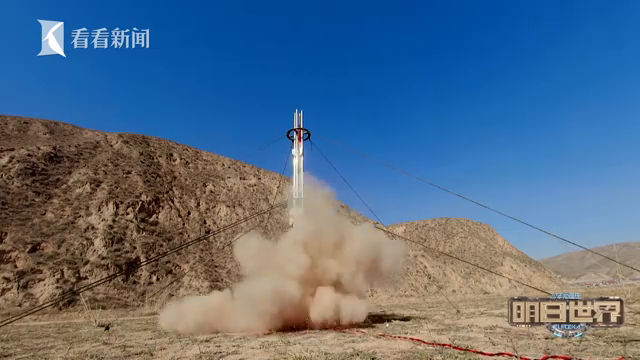
  <br>
  <em>Décollage lors de l’essai en vol dans le Gobi.</em>
</p>

<p align="center">
  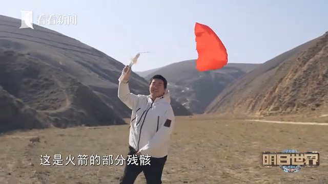
  <br>
  <em>Parachute récupéré sur le site d’atterrissage.</em>
</p>

### Extraits vidéo

<p align="center">
  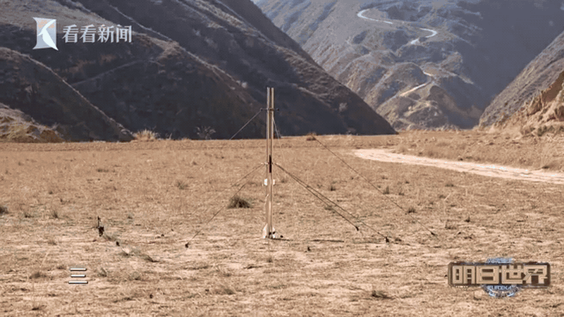
  <br>
  <em>Séquence de lancement, extrait de six secondes.</em>
</p>

<p align="center">
  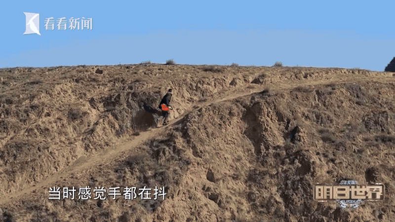
  <br>
  <em>Séquence de récupération, extrait de six secondes.</em>
</p>

<p align="center">
  <em>Extraits de l’émission de janvier 2024 ; copyright Shanghai Media Group.</em>
</p>

## Spécifications de conception

| Paramètre | Valeur | Source |
|---|---|---|
| Diamètre de la cellule | 40,0 mm | Mesuré, boîte englobante STL |
| Profil de l’ogive | Courbe de von Kármán | Formule du rapport, vérifiée numériquement |
| Contour Command A | 30 × 40 mm | Mesuré, contour Gerber |
| Contour Power | 25,0 × 25,1 mm | Mesuré, contour Gerber |
| Contour Data | 32 × 101 mm | Mesuré, contour Gerber |
| Contour Exploration | 32 × 76 mm | Mesuré, contour Gerber |
| Microcontrôleur | RP2040 | Nomenclature et rapport |
| IMU | MPU6050 | Nomenclature |
| Baromètre | BMP280 | Nomenclature |
| GNSS | ATGM336H-5N | Rapport |
| Liaison descendante | A39C-T400A22D1a | Rapport et nomenclature |
| Capteur de poussière | GP2Y1014AU0F | Nomenclature |
| Capteurs de gaz | MQ-2, MQ-135 | Nomenclature |
| Port série de la station | 9600, 8-N-1 | Code source |
| Essai en vol | Fin automne/début hiver 2023 ; section capteurs récupérée, baie de parachute et module de propulsion perdus ; récupération estimée à 80 % | Sujet télévisé |

## Vérification

Le dépôt comprend une suite de vérification en Python pur et un registre d’errata
documenté.

- `python scripts/verify_theory/run_verification.py` : 32 tests couvrant les
  formules d’attitude, le filtre complémentaire, les quaternions, l’analyse de
  trame, la courbe de von Kármán, la géométrie STL, le contour Gerber et le coût
  de la nomenclature.
- [docs/errata.md](docs/errata.md) : 16 points examinés, avec corrections et
  preuves.
- [docs/verification.md](docs/verification.md) : relevé des tests et contrôles
  numériques.

## Contribution

Voir [CONTRIBUTING.md](CONTRIBUTING.md). Ne pas ajouter de formulation de
propergol, de procédure d’allumage ou d’instruction de lancement.

## Licence

Le code, la documentation et les médias originaux sont publiés sous
[MIT](LICENSE). Les fiches techniques tierces et le logo du concours sont exclus.
Les cinq images fixes et les deux extraits GIF du sujet télévisé sont inclus pour
la documentation ; leur copyright reste celui de Shanghai Media Group et ils ne
sont pas couverts par MIT. L’émission complète n’est pas rediffusée.

## Remerciements

Merci au lycée n° 1 de Guyuan (Ningxia) et au Concours national chinois
d’innovation scientifique et technologique pour la jeunesse. Merci à Shanghai
Media Group et à l’équipe de *Young Edison* pour le reportage. Le projet utilise
SolidWorks, EasyEDA, Python, PyQt5, Matplotlib, PySerial et OpenGL. Le rapport
original, la présentation et l’ancien code sont conservés dans
[docs/archive/](docs/archive/).
