<p align="center">
  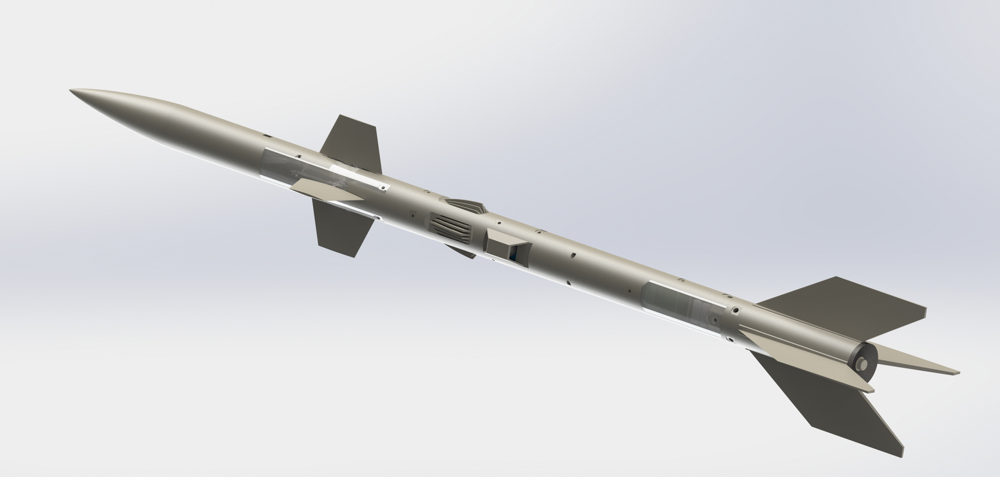
</p>

<h1 align="center">DustArrow X</h1>

<p align="center">
  <strong>A modular telemetry system for 40 mm meteorological sounding rockets</strong>
  <br>
  RP2040 sensing stack, LoRa downlink and a PyQt5 ground station
</p>

<p align="center">
  <a href="./LICENSE"></a>
  
  
  
  
  <br>
  <a href="./README.md">English</a> |
  <a href="./README.zh-CN.md">中文</a> |
  <a href="./README.fr.md">Français</a>
</p>

---

<p align="center">
  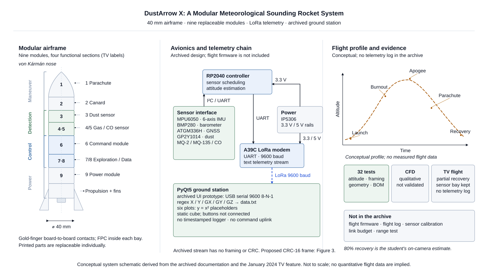
  <br>
  <em>Figure 1 | System overview. The 40 mm airframe carries nine replaceable
  modules in four functional sections; the archived avionics chain and ground
  station are shown with the proposed CRC-16 frame. The flight profile is
  conceptual: no telemetry log or quantitative flight data are present in the
  archive.</em>
</p>

## About

DustArrow X is the third documented generation of a student project from Guyuan
No. 1 Middle School, Ningxia, after Theta and Beta. It was presented at the China
Adolescents Science and Technology Innovation Contest and featured on Shanghai
TV’s *Young Edison* Season 8 in January 2024. The project measures the vertical
structure of the atmosphere during dust events with a low-cost sounding rocket.

The airframe is 40 mm in diameter. The January 2024 TV feature presents four
functional sections and a whiteboard of nine replaceable modules. This repository
maps them as maneuver (parachute, canard), detection (dust, gas, CO/smoke),
control (command, exploration, data) and power (power module, propulsion). The
CAD adds the propulsion/fin section, giving ten manufacturable bays. Modules are
joined by gold-finger board-to-board contacts, with a flexible printed circuit
inside each bay. The flight electronics centre on an RP2040 with an MPU6050, a
BMP280, an ATGM336H GNSS receiver, an A39C LoRa modem, a GP2Y1014AU0F dust
sensor and MQ-series gas sensors. The ground segment is a Python/PyQt5
application.

This repository covers the mechanical design, electronics fabrication data,
ground-station source, original report, presentation, media and the
TV-documented module nomenclature. Flight firmware source and flight logs are
outside the scope of this archive; see [firmware/README.md](firmware/README.md).

## Name origin

The Chinese name «沙尘利“箭”» combines «沙尘» (sand and dust) with «利箭» (a sharp
arrow). It refers to the sounding rocket and to a useful instrument against dust
storms. The English name **DustArrow** is a direct rendering. The modular
architecture is inspired by the experiment racks on the Chinese space station.
The third generation adds **X**; the author explains that X means “infinite
possibilities”.

## Key features

- **40 mm modular airframe** — nine replaceable modules and a propulsion/fin
  section (ten CAD bays), joined by gold-finger and FPC contacts; printed parts
  can be replaced individually.
- **RP2040 sensing stack** — six-axis IMU, barometer, GNSS, dust and gas sensors.
- **LoRa downlink** — A39C-T400A22D1a serial modem received at 9600 baud.
- **PyQt5 ground-station prototype** — serial acquisition, six placeholder plots
  and a static attitude cube; the command buttons are not wired.
- **Open fabrication files** — SolidWorks sources, STL, STEP, Gerber, BOM and
  silkscreen artwork.
- **Verification suite** — 32 Python tests and 16 documented errata covering
  attitude math, framing and geometry.

## System architecture

<p align="center">
  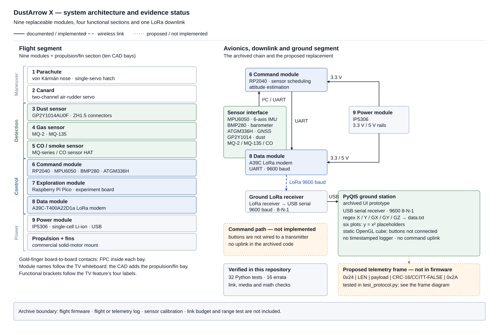
  <br>
  <em>Figure 2 | Architecture and data paths. Solid lines are documented or
  implemented links; dashed blue is the LoRa downlink; amber dotted marks the
  proposed CRC-16 frame and the command path that is not implemented in the
  archived code.</em>
</p>

The TV feature shows four functional sections and a whiteboard with nine
replaceable modules. This repository maps the whiteboard modules to those
sections as maneuver (parachute and canard), detection (dust, gas and CO/smoke
sensors), control (command, exploration and data modules) and power (power module
and propulsion). The CAD adds the propulsion/fin bay, giving ten manufacturable
bays. The module names are the whiteboard names; the grouping is an
interpretation of the broadcast labels.

<p align="center">
  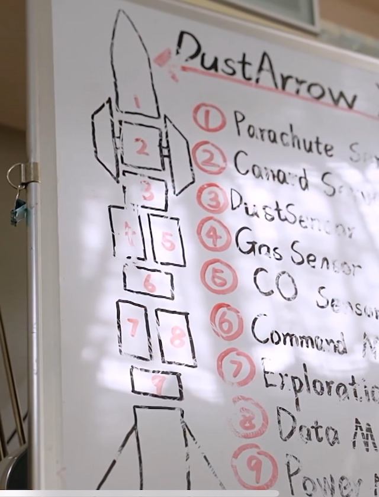
  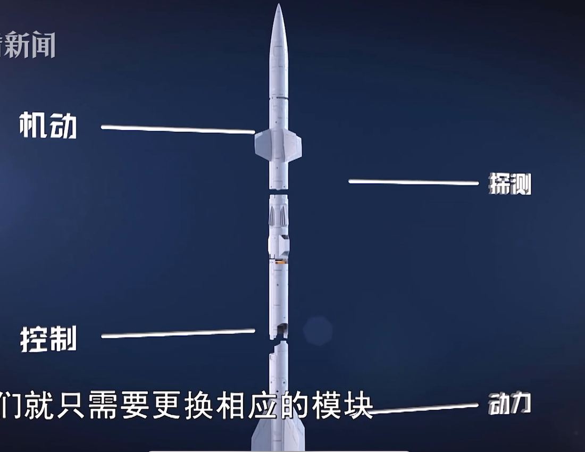
</p>
<p align="center"><em>Primary evidence for the module structure. Left: the
author’s whiteboard names nine modules (1 parachute, 2 canard, 3 dust, 4 gas,
5 CO, 6 command, 7 exploration, 8 data, 9 power). Right: the January 2024 TV
feature labels the four functional sections — maneuver, detection, control and
power. Copyright Shanghai Media Group; see Media coverage.</em></p>

<p align="center">
  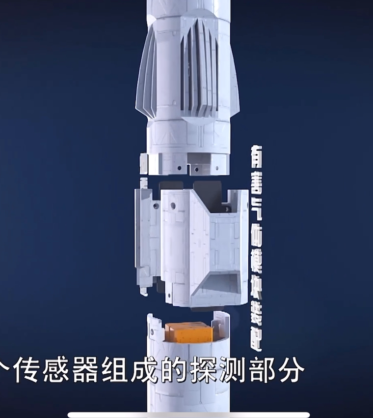
  
</p>
<p align="center"><em>Detection and interface details. Left: the three-sensor
detection section (dust, harmful gas and smoke/CO). Right: two printed modules
joined by the gold-finger board-to-board interface. Copyright Shanghai Media
Group.</em></p>

- **Mechanical** — nose and parachute bay, canard bay, three sensor modules
  (dust, gas, CO/smoke), command module, exploration module, data module, power
  module and the propulsion/fin section. The parachute uses one servo with a
  large-angle hatch; the canard bay uses a two-channel air-rudder mechanism.
- **Electronics** — nine module BOMs and ten Gerber packages. The main boards
  centre on the RP2040, MPU6050, BMP280, ATGM336H and A39C.
- **Downlink** — a 9600 baud, 8-N-1 text stream. A CRC-16 binary frame format is
  specified and tested in `scripts/verify_theory/test_protocol.py` (Figure 3).
- **Ground station** — PyQt5, Matplotlib and OpenGL; serial acquisition, text
  parsing, six placeholder plots and a static attitude cube. The command path is
  not implemented.

## Theory and design

At rest, the accelerometer measures the reaction to gravity. With $x$ forward,
$y$ right and $z$ up:

$$
\phi = \mathrm{atan2}(a_y, a_z),
\qquad
\theta = \mathrm{atan2}\left(-a_x,\sqrt{a_y^2+a_z^2}\right).
$$

The implementation uses `atan2` to preserve the quadrant. The first-order
complementary filter uses an explicit sample period:

$$
\alpha = \frac{\tau}{\tau+\Delta t},
\qquad
\theta_k = \alpha\,\theta_{\mathrm{acc},k} +
(1-\alpha)\left(\theta_{k-1} + \omega_y \Delta t\right).
$$

<p align="center">
  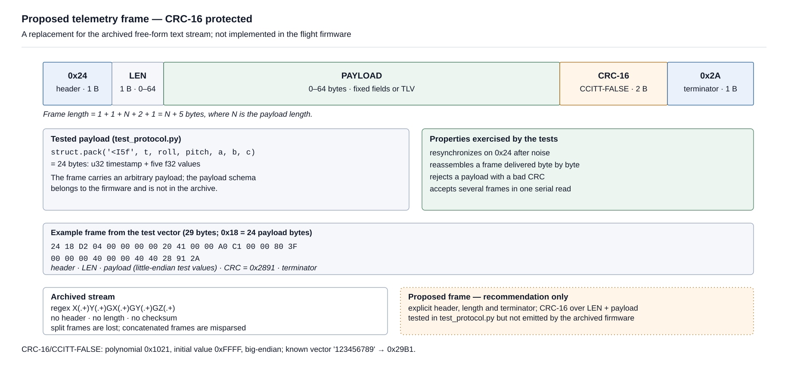
  <br>
  <em>Figure 3 | Proposed telemetry frame. The frame is tested in
  <code>scripts/verify_theory/test_protocol.py</code> and is a recommendation,
  not a description of the archived firmware.</em>
</p>

The archived ground station instead uses a free-form text stream
(`X...Y...GX...GY...GZ...`) with no header, length or checksum. See
[System design](docs/en/system_design.md) for the data path.

The full derivation, coordinate conventions and corrections are in
[Theory of operation](docs/en/theory_of_operation.md) and the
[errata](docs/errata.md).

## Repository structure

```text
DustArrow/
├── BOM/                     # consolidated bill of materials
├── electronics/
│   ├── datasheets/          # manufacturer datasheets
│   ├── output/              # Gerber, BOM, silkscreen, PCB 3D
│   └── source/              # legacy EasyEDA project
├── mechanical/
│   ├── output/              # STL, STEP, reprint files
│   └── source/              # SolidWorks drafts, formal parts, reprints
├── simulation/cfd/          # CFD project and animations
├── software/ground_station/ # PyQt5 ground-station source
├── firmware/                # interface and protocol notes
├── docs/                    # trilingual docs, errata, verification, archive
├── media/                   # photos, GIFs, videos
├── scripts/verify_theory/   # reproducible tests
└── .github/                 # issue and PR templates
```

Mechanical sources keep their original Chinese filenames because SolidWorks
assemblies resolve parts by name. STL outputs use English names and include a
`part_name_mapping.csv`. The full path mapping is in
[MIGRATION_NOTES.md](MIGRATION_NOTES.md).

## Bill of materials

| Metric | Value |
|---|---:|
| PCB modules | 9 |
| BOM line items | 48 |
| Parts | 57 |
| Priced subtotal | CNY 31.44 |
| Lines without price | 11 |
| Lines without supplier name | 16 |

Prices are from the 2023-08-15 module exports. Eleven lines have no price and
sixteen lines have no supplier name. The complete line-item table is in
[BOM/bill_of_materials.csv](BOM/bill_of_materials.csv); the per-module summary is
in [BOM/bom_summary.csv](BOM/bom_summary.csv).

## Getting started

**Ground station** (Python 3.11):

```bash
cd software/ground_station
python -m pip install -r requirements.txt
python appMain.py
```

The archived application is Windows-only: it calls `ctypes.windll` at import and
does not start on macOS or Linux. It enumerates serial ports, opens 9600 8-N-1,
parses `X`, `Y`, `GX`, `GY`, `GZ` fields and writes `data.txt`. See
[software/ground_station/README.md](software/ground_station/README.md) for the
implemented data path.

**Mechanical and electronics**: open the assemblies in
[mechanical/source/formal/](mechanical/source/formal/) or use the STL files in
[mechanical/output/3dp/](mechanical/output/3dp/). PCB fabrication files are in
[electronics/output/gerber/](electronics/output/gerber/). The step-by-step
procedure is in the [replication guide](docs/en/replication_guide.md).

**Verification**:

```bash
python scripts/verify_theory/run_verification.py
```

## Demo and testing

<p align="center">
  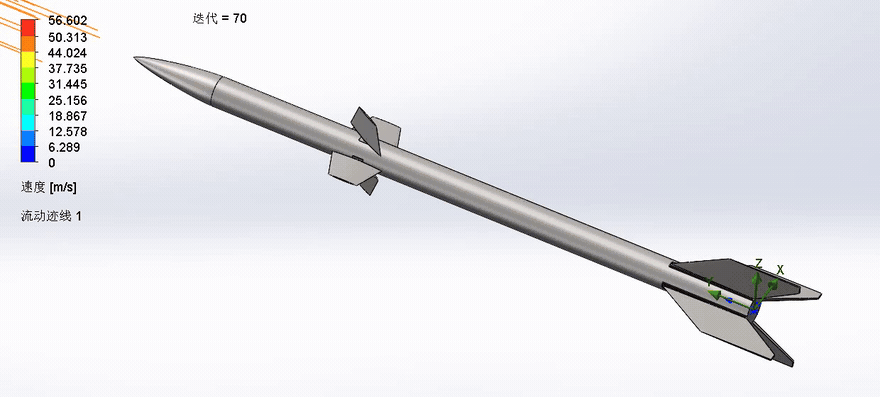
  <br>
  <em>CFD demonstration. Original videos are in media/videos/.</em>
</p>

<p align="center">
  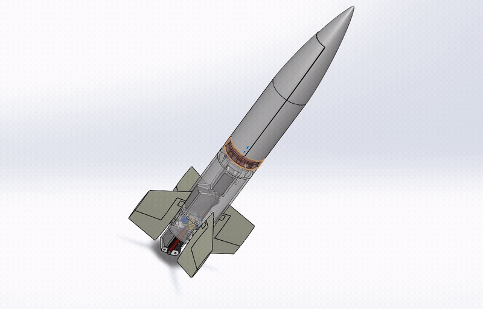
  <br>
  <em>Mechanism animation: nose separation, canard deployment and recovery.</em>
</p>

<p align="center">
  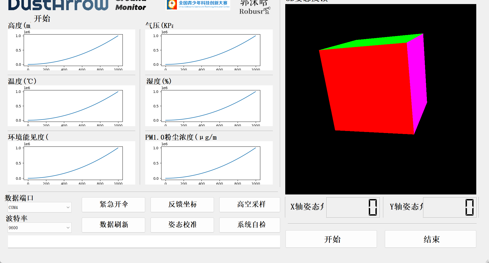
  <br>
  <em>Archived ground-station interface. The six plots are placeholders and the
  command buttons are not connected.</em>
</p>

Verification result: 32 tests pass. The suite covers attitude formulas,
complementary filtering, quaternions, frame parsing, the von Kármán profile, STL
geometry, Gerber outlines and BOM cost. See
[Verification](docs/verification.md).

## Media coverage

In January 2024, Shanghai TV’s youth science programme *Young Edison* Season 8,
*Tomorrow’s World*, featured the project. The episode documents a test flight
near Guyuan in late autumn or early winter 2023. Remote ignition was replaced by
wired ignition, and the rocket left the rail. The sensor section was recovered;
the parachute bay and propulsion module were lost. The student estimates 80%
recovery completeness. The episode also explains that X means “infinite
possibilities” and shows the ground station reading a text file for attitude
feedback. Five flight-related stills and two short excerpts from the episode are
included below. Three module and assembly stills and one GIF from the same
feature are used in [System architecture](#system-architecture); the same rights
note applies.

- [Detailed media coverage](docs/en/media_coverage.md)
- Official pages: [preview](https://www.kankanews.com/detail/ELwxNKJWGy9),
  [episode](https://www.kankanews.com/detail/LMwVGm9WB2z),
  [season overview](https://www.kankanews.com/detail/boy4AKjBxQ1)

### Program stills

<p align="center">
  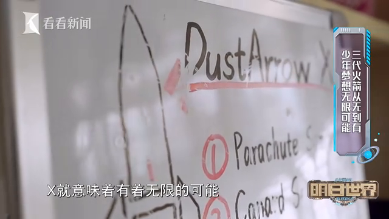
  <br>
  <em>DustArrow X whiteboard and printed airframe.</em>
</p>

<p align="center">
  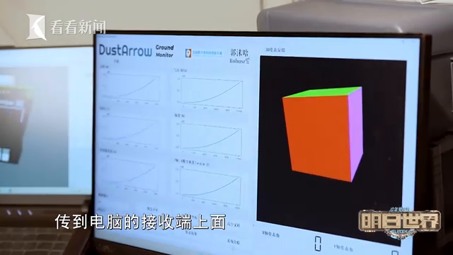
  <br>
  <em>Ground-station interface during the programme.</em>
</p>

<p align="center">
  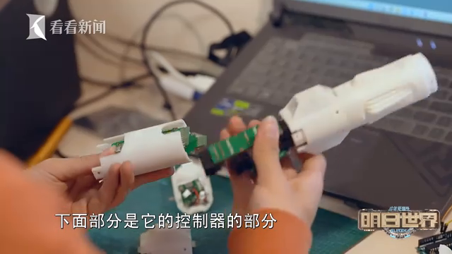
  <br>
  <em>Modular bays during assembly.</em>
</p>

<p align="center">
  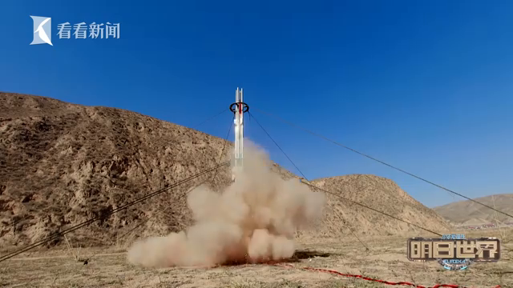
  <br>
  <em>Lift-off during the Gobi test flight.</em>
</p>

<p align="center">
  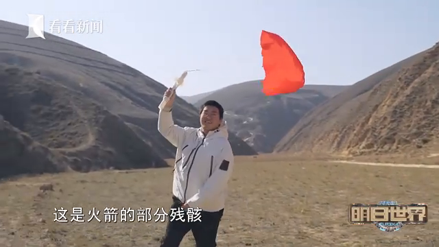
  <br>
  <em>Recovered parachute at the landing site.</em>
</p>

### Program clips

<p align="center">
  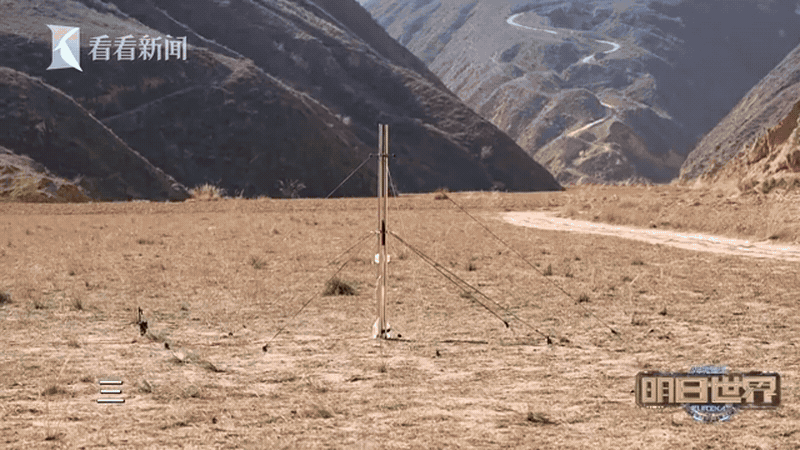
  <br>
  <em>Launch sequence, six-second excerpt.</em>
</p>

<p align="center">
  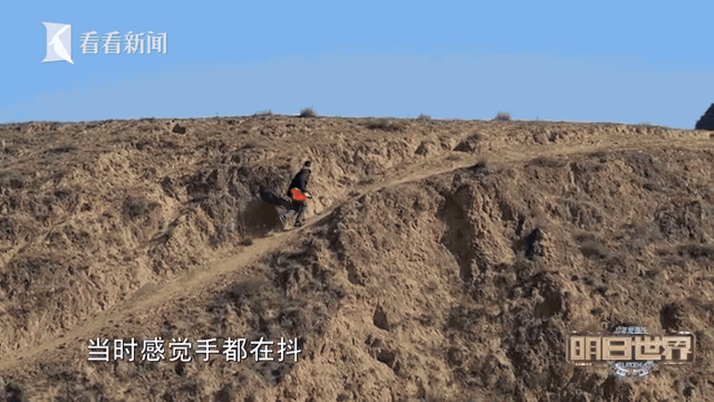
  <br>
  <em>Recovery sequence, six-second excerpt.</em>
</p>

<p align="center">
  <em>Excerpts from the January 2024 programme; copyright Shanghai Media Group.</em>
</p>

## Design specifications

| Parameter | Value | Source |
|---|---|---|
| Airframe diameter | 40.0 mm | Measured, STL bounding box |
| Replaceable modules | 9 (whiteboard, TV feature) | TV feature |
| Functional sections | 4: maneuver, detection, control, power | TV feature |
| CAD bays | 10, including the propulsion/fin section | CAD and report |
| Nose profile | von Kármán curve | Report formula, checked numerically |
| Command A outline | 30 × 40 mm | Measured, Gerber outline |
| Power outline | 25.0 × 25.1 mm | Measured, Gerber outline |
| Data outline | 32 × 101 mm | Measured, Gerber outline |
| Exploration outline | 32 × 76 mm | Measured, Gerber outline |
| Microcontroller | RP2040 | BOM and report |
| IMU | MPU6050 | BOM |
| Barometer | BMP280 | BOM |
| GNSS | ATGM336H-5N | Report |
| Downlink | A39C-T400A22D1a | Report and BOM |
| Dust sensor | GP2Y1014AU0F | BOM |
| Gas sensors | MQ-2, MQ-135 | BOM |
| Ground serial | 9600, 8-N-1 | Source code |
| Flight test | 2023 late autumn/early winter; sensor section recovered, parachute bay and propulsion module lost; 80% recovery estimate | TV feature |

## Verification

The repository includes a pure-Python verification suite and a documented errata
record.

- `python scripts/verify_theory/run_verification.py` — 32 tests covering attitude
  formulas, complementary filtering, quaternions, frame parsing, the von Kármán
  profile, STL geometry, Gerber outlines and BOM cost.
- [docs/errata.md](docs/errata.md) — 16 reviewed items with corrections and
  evidence.
- [docs/verification.md](docs/verification.md) — test record and numerical
  cross-checks.

## Contributing

See [CONTRIBUTING.md](CONTRIBUTING.md). Do not submit propellant formulations,
ignition procedures or launch instructions.

## License

Code, documentation and original media are released under [MIT](LICENSE).
Third-party manufacturer datasheets and the contest logo are excluded. The eight
stills and three GIF excerpts from the Shanghai TV feature are included for
documentation; their copyright remains with Shanghai Media Group and they are
not covered by MIT. The full programme is not redistributed.

## Acknowledgments

Thanks to Guyuan No. 1 Middle School, Ningxia, and the China Adolescents Science
and Technology Innovation Contest for the platform. Thanks to Shanghai Media
Group and the *Young Edison* team for documenting the project. The project uses
SolidWorks, EasyEDA, Python, PyQt5, Matplotlib, PySerial and OpenGL. The original
report, presentation and legacy code are preserved in
[docs/archive/](docs/archive/).
